<div align="center">


<h3>An AWS security scanner that shows how an attacker gets from the internet to your data,<br>then fixes it only after a second person approves.</h3>

[](https://cloud-security-posture-delta.vercel.app)
[](https://github.com/anshumaan12-2003/nimbus-risk-sentinel/actions/workflows/ci.yml)
[](https://github.com/anshumaan12-2003/nimbus-risk-sentinel/actions/workflows/codeql.yml)
[](https://github.com/anshumaan12-2003/nimbus-risk-sentinel/releases/latest)
[](LICENSE)

<a href="#-try-it-in-30-seconds"><b>Try it</b></a> &nbsp;·&nbsp;
<a href="#-what-it-does"><b>What it does</b></a> &nbsp;·&nbsp;
<a href="#-what-it-checks"><b>Checks</b></a> &nbsp;·&nbsp;
<a href="#-architecture"><b>Architecture</b></a> &nbsp;·&nbsp;
<a href="#-quick-start"><b>Run it</b></a> &nbsp;·&nbsp;
<a href="#-security"><b>Security</b></a>

</div>

<br>

<picture>
  <source media="(prefers-color-scheme: dark)" srcset="docs/readme/overview-dark.png">
  <source media="(prefers-color-scheme: light)" srcset="docs/readme/overview-light.png">
  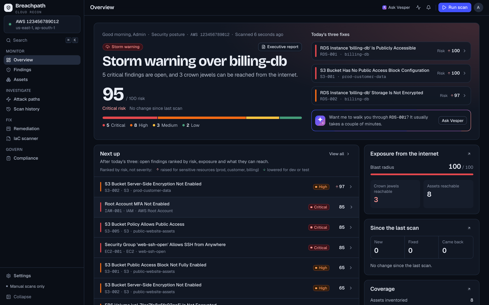
</picture>

## ⚡ Try it in 30 seconds

<table>
<tr><td><b>Open</b></td><td><a href="https://cloud-security-posture-delta.vercel.app">cloud-security-posture-delta.vercel.app</a></td></tr>
<tr><td><b>Email</b></td><td><code>admin@breachpath.local</code></td></tr>
<tr><td><b>Password</b></td><td><code>breachpath-demo-password</code></td></tr>
</table>

The demo scans a **simulated AWS account** ([moto](https://github.com/getmoto/moto)) with planted problems, so nothing touches real AWS.
`engineer@`, `approver@` and `viewer@` use the same password: sign in as two of them to try the approval from both sides.
It runs on a free server, so the first load can take up to a minute if it has been idle.

## ✨ What it does

<table>
<tr>
<td width="58%">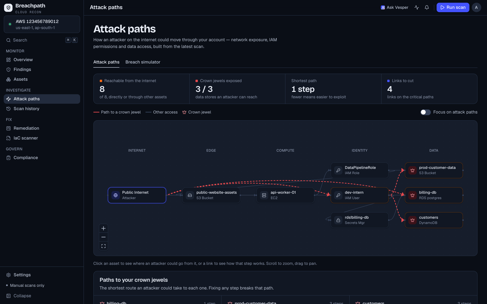</td>
<td valign="top">

### 🕸️ Shows the path, not just the list

Most scanners hand you a list of findings. Breachpath links them into a graph: internet → edge → compute → identity → data.

You see which data stores an attacker can reach, in how many steps, and which link to cut.

</td>
</tr>
<tr>
<td valign="top">

### 🎯 Finds the fewest fixes

The breach simulator starts an attacker anywhere and replays the breach. Cut a link and it recomputes what is still reachable.

**Apply fix plan** works out the smallest set of fixes that cuts off every crown jewel.

</td>
<td width="58%">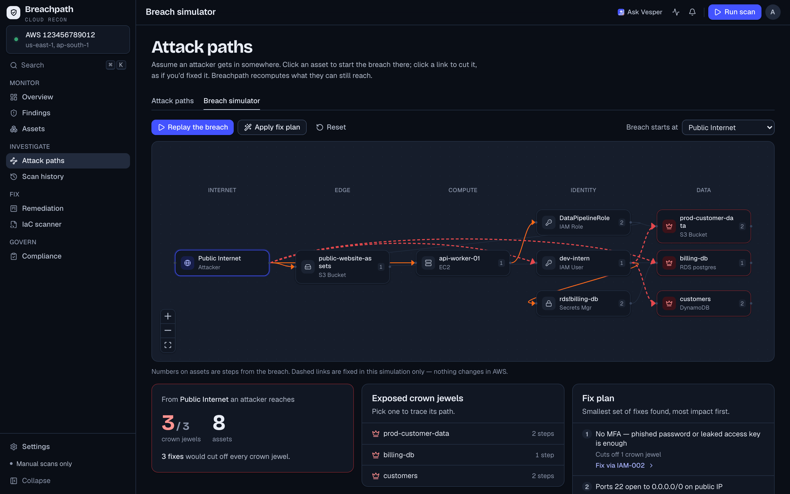</td>
</tr>
<tr>
<td width="58%">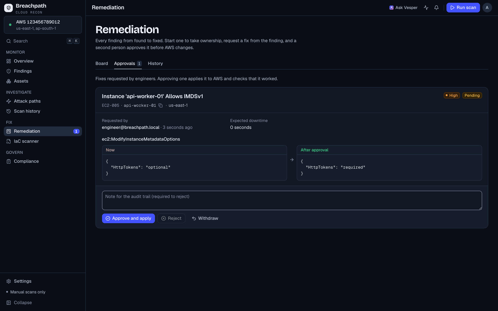</td>
<td valign="top">

### 🛡️ Fixes need a second person

An engineer requests a fix and sees the exact AWS call with before and after. A *different* person approves it.

Breachpath applies the change with a separate write role, then re-reads AWS to prove it worked. Every step is audited.

</td>
</tr>
</table>

<p align="center">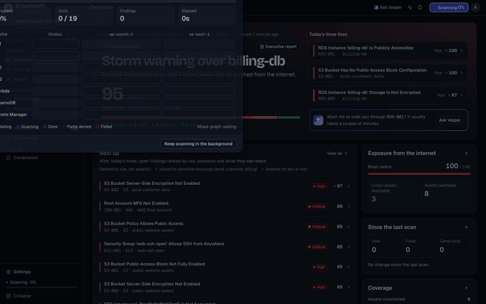</p>
<p align="center"><sub><b>Live scans.</b> Progress per service and region is pushed over WebSocket, including any permission gaps.</sub></p>

**Also inside**

<table>
<tr><td width="30%">📊 <b>Risk, not just severity</b></td><td>Scores rise for exposed or sensitive resources and drop for dev and test, so a High can outrank a Critical.</td></tr>
<tr><td width="30%">📋 <b>Compliance</b></td><td>Every rule maps to CIS, SOC 2, PCI DSS and HIPAA controls. Controls nobody checked are never shown as passing.</td></tr>
<tr><td width="30%">🗂️ <b>Remediation board</b></td><td>Open → In progress → Awaiting approval → Fixed, with owners and SLA countdowns.</td></tr>
<tr><td width="30%">🤖 <b>Vesper assistant</b> <kbd>⌘ J</kbd></td><td>Answers questions about your latest scan and cites findings as clickable chips. Falls back to scan facts when no AI key is set.</td></tr>
<tr><td width="30%">🧱 <b>Terraform scanner</b></td><td>Checks Terraform files for the same kinds of mistakes before they are deployed.</td></tr>
<tr><td width="30%">🔁 <b>Scan history</b></td><td>What is new, fixed or back since the last scan, plus an executive report.</td></tr>
<tr><td width="30%">⌨️ <b>Keyboard first</b> <kbd>⌘ K</kbd></td><td>Command palette, <code>g</code> shortcuts, light and dark themes, and a phone layout.</td></tr>
</table>

<details>
<summary><b>More screenshots</b></summary>
<br>
<table>
<tr>
<td width="50%">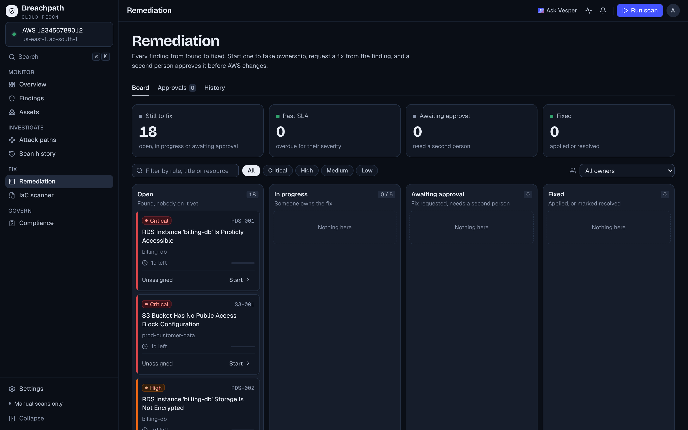</td>
<td width="50%">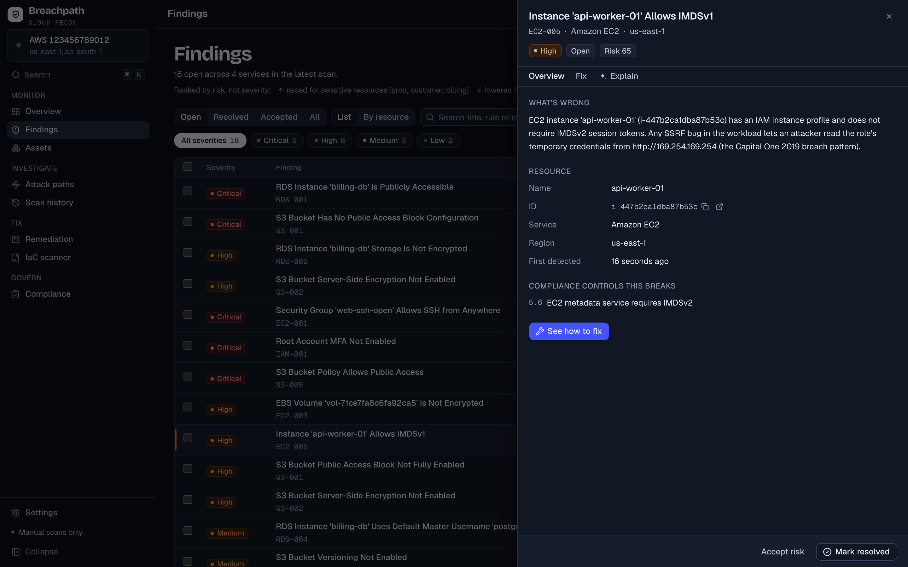</td>
</tr>
<tr>
<td>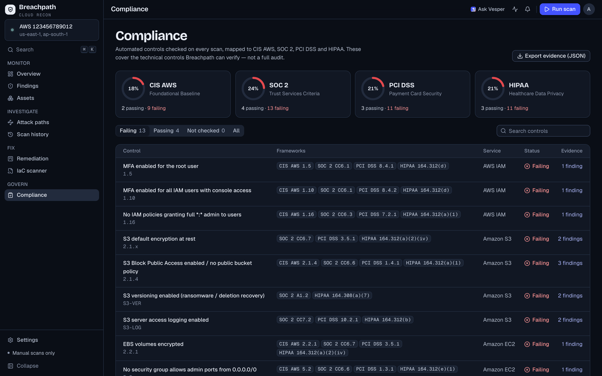</td>
<td>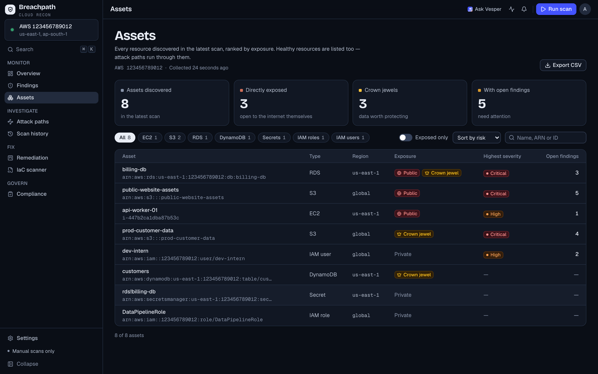</td>
</tr>
<tr>
<td>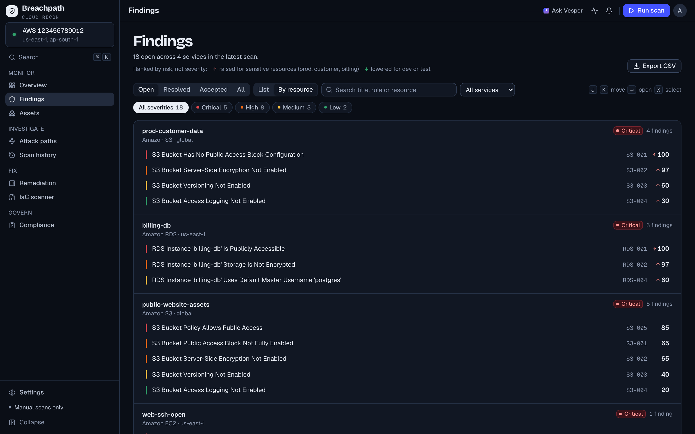</td>
<td>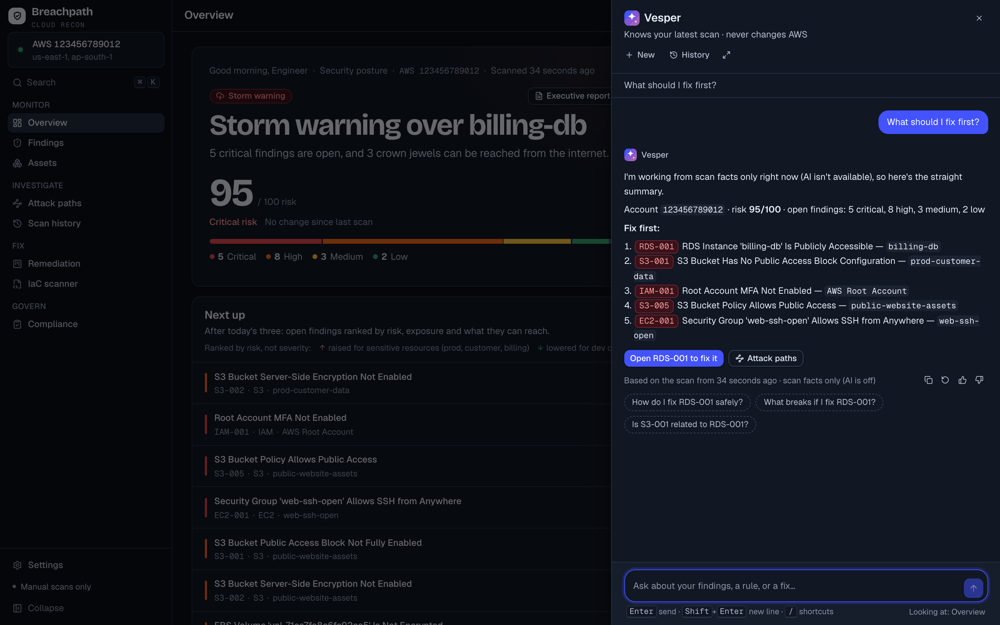</td>
</tr>
</table>
<p align="center">
  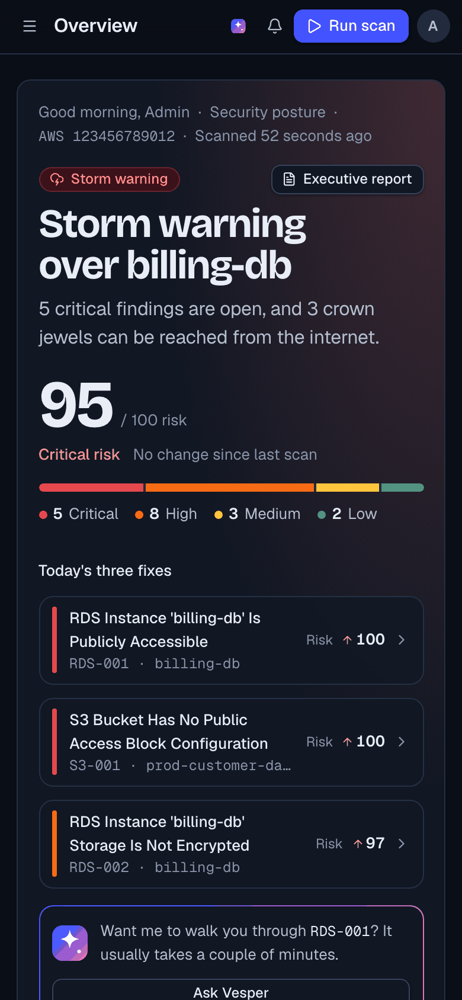&nbsp;&nbsp;
  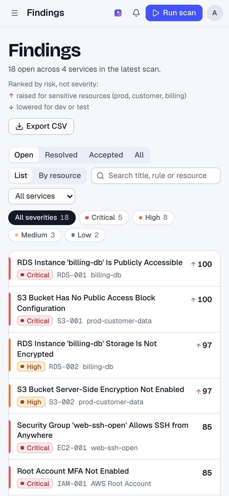&nbsp;&nbsp;
  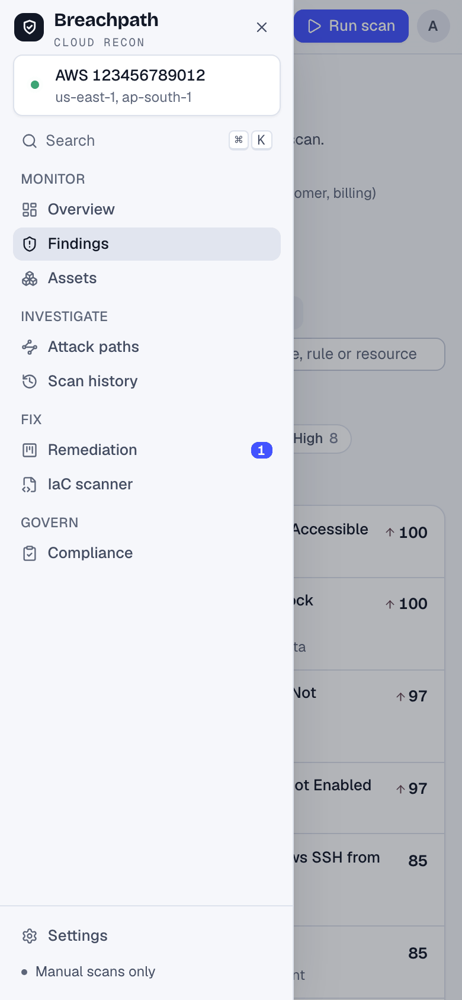
</p>
</details>

## 🔍 What it checks

19 rules across four AWS services, each mapped to CIS, SOC 2, PCI DSS and HIPAA.

| Service | Rules | Examples |
|---|:-:|---|
| **IAM** | 5 | Root account without MFA · users without MFA · administrator or wildcard access · old access keys · inactive users |
| **S3** | 5 | Public access block missing · public bucket policy · no encryption · no versioning · no access logging |
| **EC2** | 5 | SSH or RDP open to the world · public IP with all traffic allowed · unencrypted volumes · IMDSv1 allowed |
| **RDS** | 4 | Publicly accessible · storage not encrypted · backups off · default master username |

## 🏗 Architecture


<p align="center">
  
</p>

| Layer | Built with |
|---|---|
| **Frontend** | React 19, Vite, Tailwind CSS 4, TanStack Query and Table, React Flow, Motion |
| **Backend** | Python 3.12, FastAPI, SQLAlchemy 2, Alembic, Pydantic 2, boto3 |
| **Data and jobs** | PostgreSQL, Redis, Celery |
| **AI** | Google Gemini, streamed, grounded in scan facts |
| **Testing** | pytest + moto, Vitest, Playwright (flows, accessibility, visual regression) |
| **Delivery** | Docker, GitHub Actions, CodeQL, Dependabot, Render, Vercel |

<details>
<summary><b>Where things live</b></summary>

```
backend/app/
  scanner/        AWS rules (IAM, S3, EC2, RDS) and the Terraform scanner
  intelligence/   attack graph, blast radius, risk scoring, compliance map, drift
  remediation/    fixes, applied only after approval
  auth/  api/     sign-in, roles and the REST + WebSocket API
frontend/src/     React app: pages, design-system components, hooks, stores
frontend/e2e/     Playwright flows, accessibility and visual tests
infra/            AWS role setup and database backup scripts
```

</details>

## 🚀 Quick start

**Run it locally.** No AWS account needed: the demo runs on a fake, deliberately vulnerable account ([moto](https://github.com/getmoto/moto)).

```bash
cd backend && python3.12 -m venv .venv && source .venv/bin/activate
pip install -r requirements-dev.txt && python tests/dev_server_fake_aws.py
```

```bash
cd frontend && npm ci && API_PROXY_TARGET=http://127.0.0.1:8000 npm run dev
```

Open **http://localhost:3000** and sign in as `admin@breachpath.local` / `breachpath-demo-password` (`engineer@`, `approver@` and `viewer@` work too).

Prefer containers? `docker compose up --build` starts Postgres, Redis, the API, Celery and the UI.

<details>
<summary><b>Use a real AWS account or deploy it</b></summary>
<br>

- **Real account:** give Breachpath an identity with `SecurityAudit` + `ViewOnlyAccess`, copy `backend/.env.example` to `.env`, set a `SECRET_KEY` (`openssl rand -hex 32`), then `alembic upgrade head && uvicorn app.main:app --port 8000`. Fixes stay off until `REMEDIATION_ENABLED=true`.
- **Deploy:** run [`infra/aws/setup-render-scanner.sh`](infra/aws/setup-render-scanner.sh) in CloudShell, create a Render Blueprint from [`render.yaml`](render.yaml), and import the repo into Vercel with root `frontend`.

</details>

## 🔐 Security

- **Least privilege:** scanning is read-only; fixes use a separate write role and are off by default.
- **Four-eyes changes:** whoever requests a fix can't approve it, and both names are audited.
- **Hardened sessions:** Argon2id passwords, in-memory access tokens, rotating `httpOnly` refresh cookies with reuse detection.
- **Honest results:** a fix counts only after AWS is re-read to confirm it; unchecked controls are never marked as passing.

Tested with **pytest + moto**, **Vitest** and **Playwright** (flows, accessibility and visual regression) on every pull
request, alongside CodeQL, `pip-audit`, `npm audit`, secret scanning and Dependabot. Found a security problem? See
[SECURITY.md](SECURITY.md) and report it privately.

## 🗺 Roadmap

- [ ] Point the hosted demo at a real, read-only AWS account
- [ ] More services: Lambda, KMS, CloudTrail and VPC
- [ ] Multi-account scanning through AWS Organizations

## 🤝 Contributing

Issues and pull requests are welcome: [CONTRIBUTING.md](CONTRIBUTING.md) has the local setup and the checks to run.

## 📄 License

[MIT](LICENSE) © Anshumaan Singh

<br>

<div align="center">
<sub>Built by <a href="https://github.com/anshumaan12-2003">Anshumaan Singh</a> · Upgrade notes and changelog in <a href="RUNBOOK.md">RUNBOOK.md</a> · <a href="https://github.com/anshumaan12-2003/nimbus-risk-sentinel/releases">Releases</a></sub>
</div>
